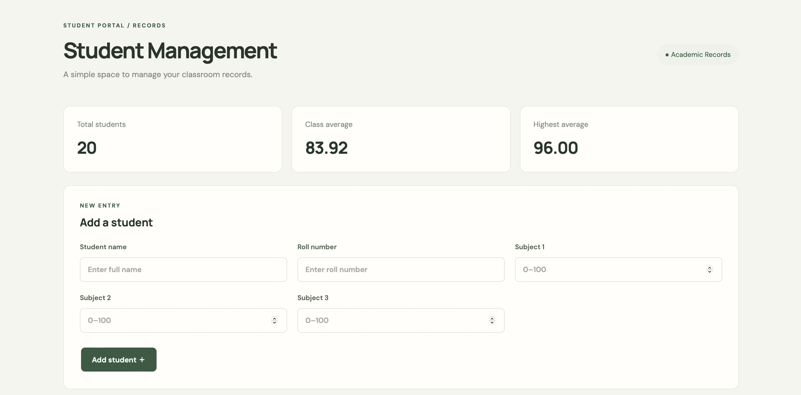
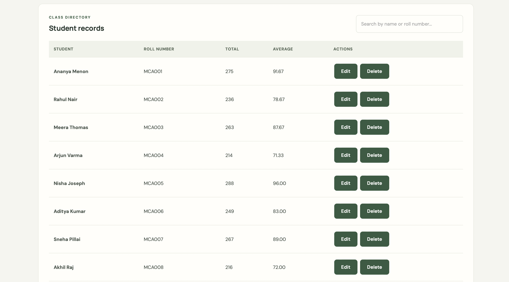

# Student Management System

A lightweight student record management application built using HTML, CSS and JavaScript.

## Features

- Add student records
- Calculate total and average marks automatically
- Edit existing student details
- Delete student records
- Search students by name or roll number
- Dashboard statistics
- Persistent storage using LocalStorage
- Responsive interface

## Technologies Used

- HTML5
- CSS3
- JavaScript
- Browser LocalStorage

## Getting Started

1. Clone this repository.
2. Open the project folder.
3. Open `index.html` in your browser.

## Project Preview

---

Developed as a personal web development project.
